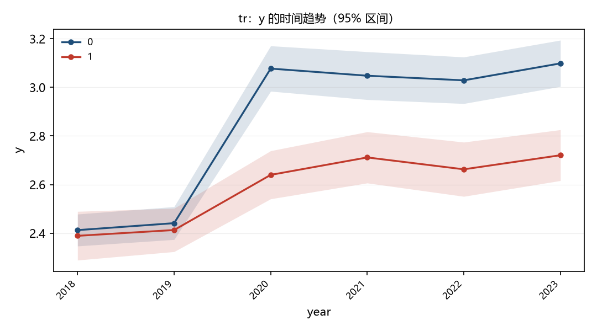

[[TITLE]] 政策冲击与市场反应：一个最小示例
[[SUBTITLE]] ——以印花税调整为例
[[AUTHORS]] 张三　李四
[[ABSTRACT]] 本文用一个虚构的最小样本演示排版链路：三线表、行内公式 $y=\alpha+\beta x$、独立公式、图与脚注。数字 1.23% 应当原样保留。
[[KEYWORDS]] 事件研究；三线表；排版
[[CLC]] [中图分类号]F832.51　[文献标识码]A

# 一、引言

正文首行缩进两字。这里验证*斜体*、**粗体**与行内公式 $CAR_i = R_i - E(R_i)$ 的混排。

## （一）二级标题示例

### 三级标题示例

- 无序条目一
- 无序条目二

1. 有序条目一
2. 有序条目二

> 引用块示例，小字号缩进。

**表 1　主要变量**

| 变量 | 均值 | 标准差 |
|---|---|---|
| CAR | -0.786 | 0.336 |
| SIZE | 8.21 | 1.15 |
| ROA | 0.043 | 0.061 |

资料来源：作者计算。

**图 1　市场反应的时间趋势**

注：阴影为 95% 置信区间。

独立公式如下：

$$\hat{\beta}_{OLS} = (X'X)^{-1}X'y$$

脚注：这是一条脚注，应当转成 Word 原生脚注。

# 参考文献

[1] 张三. 测试文献[J]. 金融研究, 2026(1): 1-10.

[2] 李四. 另一篇[J]. 经济研究, 2025(2): 20-30.
