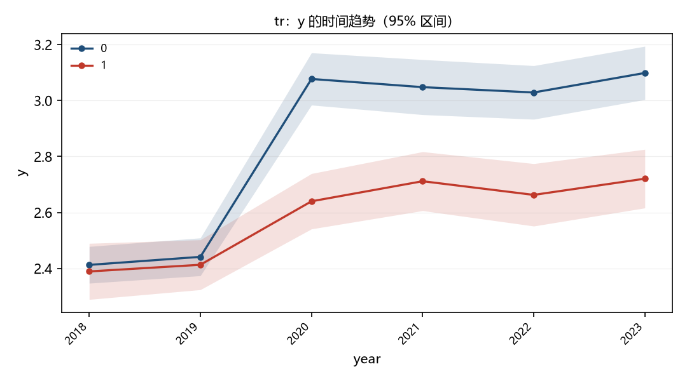

# 政策冲击与企业投资：一个最小示例

## ——基于虚构面板的演示

[[TOC]]

# 一、引言

学位版按位置认结构：第一个 `# ` 是论文题目，第一个 `## ` 是副标题，之后每个 `# ` 才是章标题。
这一行之后的内容才进入正文版式（12 磅宋体、首行缩进）。

行内公式 $y = \alpha + \beta x$，以及*斜体*和**粗体**。

## （一）研究背景

二级节标题是 Heading 2。

### 三级小节

三级标题是 Heading 3。

**表 1　主要变量**

| 变量 | 均值 | 标准差 |
|---|---|---|
| CAR | -0.786 | 0.336 |
| SIZE | 8.21 | 1.15 |

注：作者计算。

**图 1　趋势图**

独立公式：

$$
\hat{\beta} = (X'X)^{-1}X'y
$$

# 二、研究设计

第二章正文示例。

## （一）样本选择

样本选择的说明。

# 参考文献

张三. 测试文献[J]. 金融研究, 2026(1): 1-10.
李四. 另一篇[J]. 经济研究, 2025(2): 20-30.
